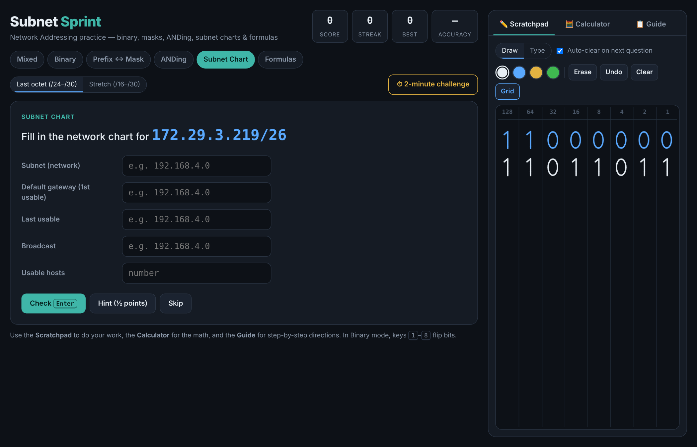
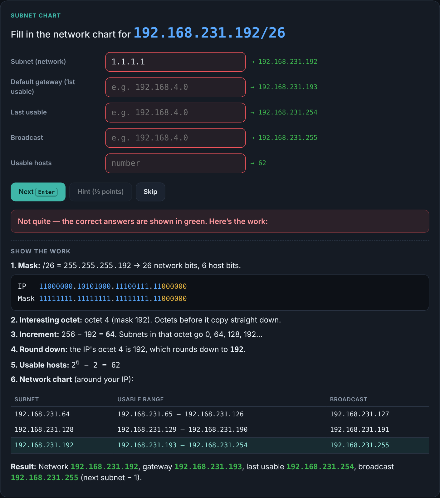
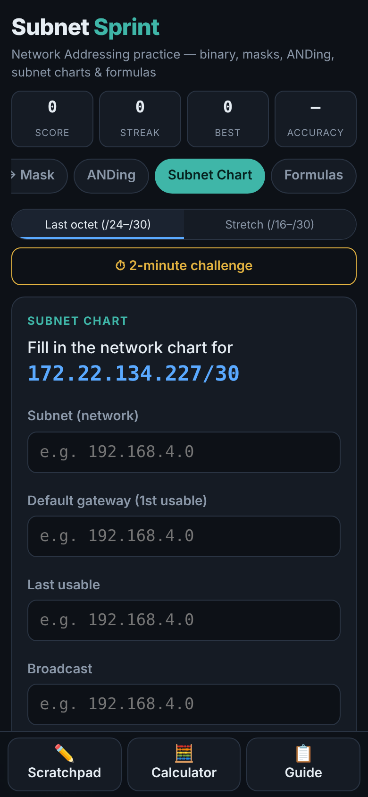
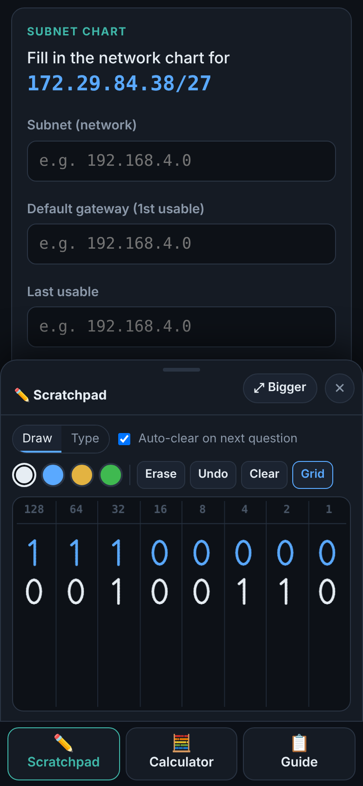
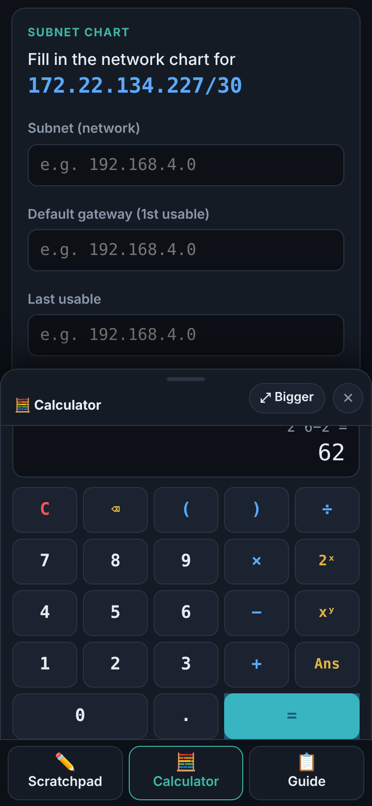

# Subnet Sprint

**An interactive study game for IPv4 network addressing and subnetting.**

Practice binary conversion, prefix ↔ subnet mask, ANDing, full subnet charts, and the host/network formulas. Every question is randomly generated, every answer comes with a worked solution, and it has a built-in scratchpad, calculator and step-by-step guide, so you don't need pen and paper.

### ▶ [Play it here](https://christiankrantz11.github.io/subnet-sprint/)

Works in any modern browser on desktop, tablet or phone. No install, no account, no tracking.



---

## Features

### Six practice modes
| Mode | What you practice |
|---|---|
| **Binary** | Decimal → binary (tap the 128 / 64 / 32 … bits) and binary → decimal |
| **Prefix ↔ Mask** | `/26` → `255.255.255.192` and back |
| **ANDing** | IP + mask → network address |
| **Subnet Chart** | Given `IP/prefix`, fill in the network, default gateway, last usable, broadcast and usable hosts |
| **Formulas** | Usable hosts (2ʰ − 2), subnets (2ⁿ), network increment, "smallest subnet for X hosts", "bits to borrow for N subnets" |
| **Mixed** | A random mix of everything |

### Two difficulty levels
- **Last octet (/24–/30):** subnetting inside the 4th octet. Start here.
- **Stretch (/16–/30):** the subnet boundary can land in the 3rd octet.

### Learn from every answer
- Wrong answers show the correct value in green, plus **Show the work**: the IP and mask lined up in binary (network bits blue, host bits yellow), the increment, and a small subnet table with your network highlighted.
- **Hint** gives you the method for half points and links straight to the matching section of the guide.



### Built-in tools
- **✏️ Scratchpad:** draw with a mouse, finger or stylus over an optional 128 → 1 bit grid (four pen colours, eraser, undo). Or switch to **Type** mode, which has one-tap bit-header and subnet-chart templates. It can clear itself on each new question.
- **🧮 Calculator:** + − × ÷, parentheses, **2ˣ**, **xʸ**, **Ans**, and a tappable history. It deliberately has no binary converter or subnet calculator, so it helps with the math without giving away answers.
- **📋 Guide:** step-by-step directions for subnet charts, ANDing, the "round down" rule, binary, prefix ↔ mask, formulas and stretch mode, each with a worked example, plus a /24–/30 reference table.

### Score & challenge
- Score, streak, best streak and accuracy, plus per-mode counts on each tab.
- **⏱ 2-minute challenge:** answer as many mixed questions as you can, then try to beat your personal best.

### Mobile-friendly
On phones, the tools open from a bottom bar as a half-height panel, so the question stays visible while you work. Tap **Bigger** for a near-full-screen scratchpad (the question stays pinned at the top). Answer boxes bring up the number keyboard, and **Go** jumps to the next box.

<p>
  
  
  
</p>

### Keyboard shortcuts (desktop)
| Key | Action |
|---|---|
| `Enter` | Check answer / next question |
| `1`–`8` | Flip bits left to right in Binary mode |
| `Enter` / `Esc` in the calculator | Evaluate / clear |

---

## How subnetting works (quick version)

Using `172.16.62.68/26`:

1. **Prefix → mask:** /26 = 26 ones → `255.255.255.192`
2. **Interesting octet:** the one that isn't 255 or 0 → the 4th (`192`)
3. **Increment:** 256 − 192 = **64**
4. **List subnets:** 0, 64, 128, 192
5. **Round down:** 68 falls in the **.64** subnet
6. **Fill in:** network `.64` · gateway `.65` · last usable `.126` · broadcast `.127` (next subnet − 1) · hosts 2⁶ − 2 = **62**

The in-app Guide covers ANDing, binary, formulas and /16–/23 prefixes the same way.

---

## Running it locally

The whole app is one self-contained file, [`index.html`](index.html), with no build step and no dependencies. Download it and open it in a browser.

To host it yourself, any static host works (GitHub Pages, Netlify, a USB stick…).

## Tests

The `tests/` folder has two [Playwright](https://playwright.dev/python/) scripts:

- **`test_answers.py`** generates hundreds of random questions in every mode and at both levels, computes the correct answers independently with Python's `ipaddress` module, types them in, and checks that the game marks them correct and that every explanation renders cleanly.
- **`test_ui.py`** runs 87 checks of every control: hints, scoring, streaks, timed challenge, scratchpad drawing/erasing/undo, typed notes, calculator, guide, keyboard shortcuts, the phone layout and bottom panel, and running with browser storage blocked.

```bash
pip install playwright
playwright install chromium
python tests/test_answers.py      # N=200 python tests/test_answers.py for a longer run
python tests/test_ui.py
```

## Built with

Plain HTML, CSS and JavaScript in a single file, with fonts from Google Fonts ([Inter](https://fonts.google.com/specimen/Inter), [JetBrains Mono](https://fonts.google.com/specimen/JetBrains+Mono)). Best streak and challenge scores are saved only in your own browser.

## About

Made by **Christian Krantz** as a study aid for the network addressing unit of the AAS Networking & Cybersecurity program at State Technical College of Missouri.

## License

[MIT](LICENSE)
