# Subnet Sprint

**An interactive study game for IPv4 network addressing and subnetting.**

Practice binary conversion, prefix ↔ subnet mask, ANDing, full subnet charts, and the host/network formulas. Every question is randomly generated, every answer comes with a worked solution, and it has a built-in scratchpad, calculator and step-by-step guide, so you don't need pen and paper. Instructors can also load their own problems, share them as a link, print worksheets with an answer key, and project a problem in Present mode.

### ▶ [Play it here](https://christianjkrantz.github.io/subnet-sprint/)

Works in any modern browser on desktop, tablet or phone. No install, no account, no tracking.

It has a green-on-black terminal look with falling "code rain" in the background. The rain pauses when the tab is hidden, and if your device is set to reduce motion it shows a still frame instead.

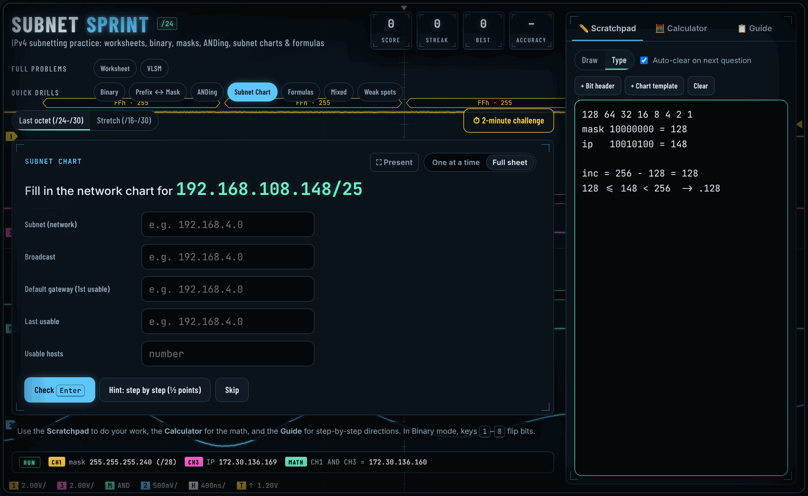

---

## Features

### Practice modes
| Mode | What you practice |
|---|---|
| **Worksheet** | The full class worksheet for an IP and mask: mask in dotted decimal and binary, increment, network and broadcast, whether the IP is a network/host/broadcast address, total networks (2ⁿ), hosts per network (2ʰ − 2), and the network chart |
| **VLSM** | The class VLSM assignment: split a /24 biggest-first into subnets sized for their hosts, with the bit grid (1s for network bits, 0s for host bits), subnet mask, network, useable host range and broadcast for each subnet, plus the network after the last one |
| **Packet Tracer lab** | The Cisco “Subnetting Scenario” lab (11.7.5): count the subnets a topology needs, borrow bits, the binary subnet values, the new mask, the subnet table, assigning subnets to links, the Addressing Table, and the IOS commands to configure a router, a switch and a PC |
| **Binary** | Decimal → binary (tap the 128 / 64 / 32 … bits) and binary → decimal |
| **Prefix ↔ Mask** | `/26` → `255.255.255.192` and back, and masks written out in 32-bit binary |
| **ANDing** | IP + mask → network address |
| **Subnet Chart** | Given `IP/prefix`, fill in the network, broadcast, default gateway, last usable and usable hosts (in the order you work them out); plus quick “network, host or broadcast?” questions |
| **Formulas** | Usable hosts (2ʰ − 2), subnets (2ⁿ), total networks from the class default (A /8, B /16, C /24), network increment, "smallest subnet for X hosts", "bits to borrow for N subnets" |
| **Mixed** | A random mix of everything |
| **Weak spots** | Drills the mistakes you make most (see below) |

### Shortcuts to memorise
The Guide has a cheat-sheet section: the mask ladder (128 → 192 → 224 → 240 → 248 → 252 → 254 → 255) with each prefix's binary, increment and host count, the powers of 2 to know, the class ranges, and the chart rules.

### Worksheet mode
Worksheet mode matches the class worksheet format: each problem gives an IP with a mask (as `/27` or `255.255.255.224`) and asks for every answer plus the network chart (network, useable host range and broadcast for each row, counting up from .0).

The questions come in the order that makes each one easiest, because each answer feeds the next:

1. **Subnet mask** (dotted decimal), then **in binary**: the mask is where everything starts.
2. **Network increment**: 256 minus the mask's interesting octet.
3. **Hosts per network** (2ʰ − 2): the host bits are the 0s you just wrote in binary.
4. **The chart**, row by row: network (count up by the increment), broadcast (next network − 1), then the usable range between them.
5. **The given IP**: its network and broadcast, read straight off the chart, and whether it's a network, host or broadcast address.
6. **Total networks** (2ⁿ) last, since it's about the whole address space rather than this IP.

#### One at a time (default)
Questions appear one at a time instead of the whole sheet at once. Each right answer drops into a growing answer sheet above, and the chart builds itself row by row as you fill it in, with the current cell highlighted. A wrong try gets a nudge toward the method (never the number) and you try again, or tap **Show the answer**. **Hint** opens the steps for just that one question. At the end you're scored on how many you got right on the first try, with an explanation of each first-try miss.

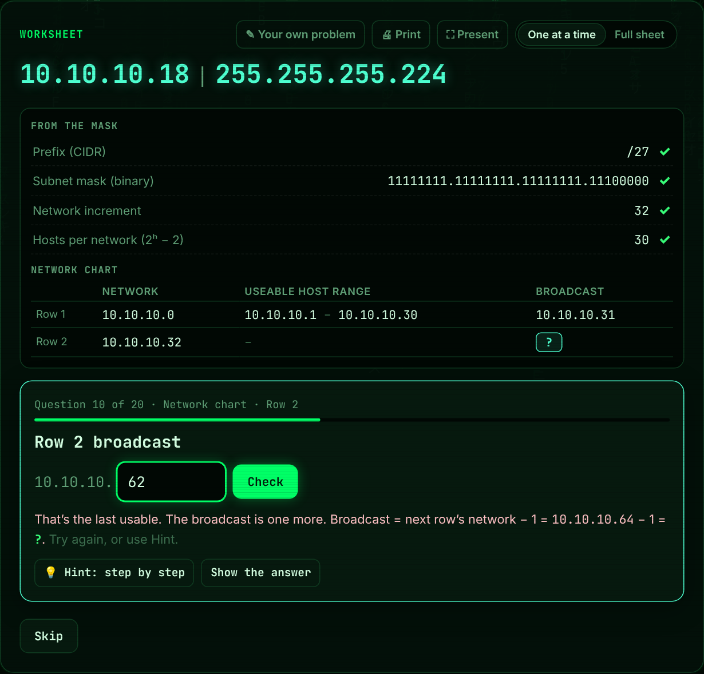

#### Full sheet
Prefer the classic worksheet? Switch to **Full sheet** at the top of the question to see every box at once. The Tab key follows the same order. It's checked box by box, with feedback on exactly what went wrong in each one, including chart cells that are only wrong because of an earlier mistake. The choice is remembered.

Total networks is counted from the IP's class default mask (10.x.x.x is Class A, /8). The /24-baseline answer is also accepted for the worksheet, since some classes count it that way.

### VLSM mode
Matches the class VLSM assignment: a /24 (usually 192.168.0.0/24) and four subnets with the hosts each one needs. Subnets are assigned biggest first, starting at .0. Each subnet is worked in this order:

1. **Bit grid**: the smallest h where 2ʰ − 2 covers the hosts, written as h 0s on the right and 1s on the left.
2. **Subnet mask**: the place values above the 1s give the last octet.
3. **Network**: the previous subnet's broadcast + 1 (the first one is .0).
4. **Broadcast**: network + block size (2ʰ) − 1.
5. **Useable host range**: network + 1 to broadcast − 1.

The last row is the network after the final subnet. Random problems often land right on the edges, like 15 hosts (one too many for 14) or 7 hosts (one too many for 6), so you practice the cases people miss. Feedback catches the usual VLSM mistakes: a block that's too small or bigger than needed, forgetting the − 2, the block size typed as the mask, adding the hosts needed instead of the block size, and starting a subnet on the previous broadcast.

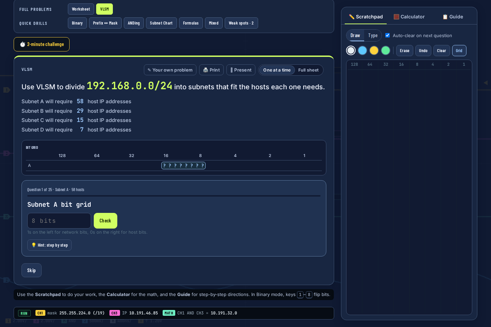

### Packet Tracer lab mode
Follows the Cisco Packet Tracer “Subnetting Scenario” lab. Each problem draws a topology: two routers joined by a serial link, with one to three LANs each (router port → switch → PC). You're given a /24 and how many addresses each LAN needs, then work through the lab in its own order:

- **Step 1:**
  - how many subnets are needed (the LANs plus the WAN link)
  - how many bits to borrow, and how many subnets and usable hosts that creates
  - the binary value of each subnet
  - the new mask in binary and decimal
  - the full subnet table
- **Step 2:** assign the subnets to the links: R1's LANs, then R2's, then the WAN link.
- **Step 3:** fill in the Addressing Table by the lab's rules:
  - routers get the first usable address on their LANs
  - R1 gets the first usable address on the WAN link, and R2 the last
  - switches get the second usable address
  - PCs get the last usable address
  - switches and PCs use their router's LAN address as the default gateway
- **Part 2:** type the IOS commands at a real-looking prompt (`R1(config-if)#`). You select interfaces, set `ip address` with a dotted-decimal mask, use `no shutdown`, `end` and `copy running-config startup-config`, set up the switch's VLAN 1 address and `ip default-gateway`, configure the PC, and `ping` its gateway. Common abbreviations (`en`, `conf t`, `int g0/0`, `ip add`, `no shut`, `copy run start`) are accepted.

Feedback catches the usual mistakes:
- forgetting the WAN link
- borrowing too many or too few bits
- writing the subnet number in the wrong bits
- giving R2 the WAN link's first address
- a PC's gateway set to the switch
- a `/27` instead of a dotted-decimal mask
- `shutdown` instead of `no shutdown`
- `exit` instead of `end`
- saving the wrong way

The part picker lets you drill one section at a time (Step 1, Steps 2–3, or Part 2), with the earlier results shown for reference.

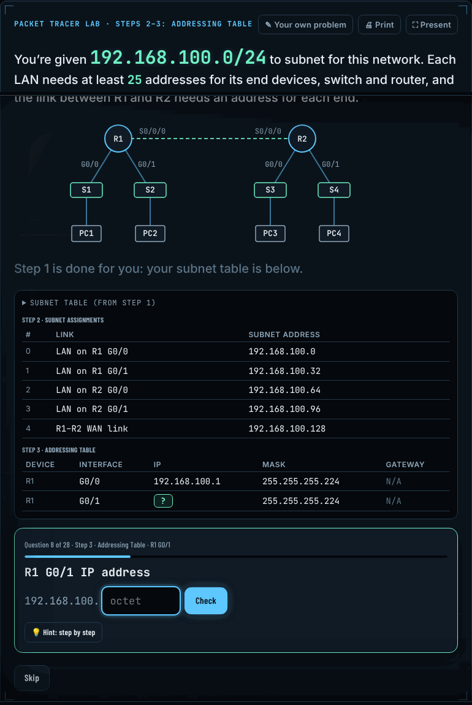

### For instructors
- **Your own problem:** in Worksheet mode, type any IP and mask (`/25`–`/30` or dotted decimal, Class A, B or C) to load that exact worksheet, for example to walk through a textbook problem in class. It gives you a **share link** that opens the same problem for students. Add `&layout=sheet` to a link to open it as a full sheet instead of one at a time.
- **Your own VLSM problem:** in VLSM mode, type the hosts each subnet needs (for example `58, 29, 15, 7`) and optionally a different starting /24. They're sorted biggest first, and you get a share link like `?vlsm=58,29,15,7`.
- **Your own lab:** in Packet Tracer lab mode, set the /24, addresses per LAN and LANs per router. One button loads the class lab (192.168.100.0, 25 addresses, 2 + 2 LANs). Share links look like `?lab=192.168.100.0&hosts=25&r1=2&r2=2`.
- **Print:** prints 2–10 random worksheet, VLSM or lab problems (whichever mode you're in). Labs print like the class handout, each on its own pages (optionally starting with the current one), two per page, with an optional answer key on separate pages.
- **Present:** hides the side tools and score and enlarges the problem for a projector. Click again to leave.

Total networks is counted from the IP's class default mask (10.x.x.x is Class A, /8). The /24-baseline answer is also accepted for the worksheet, since some classes count it that way.

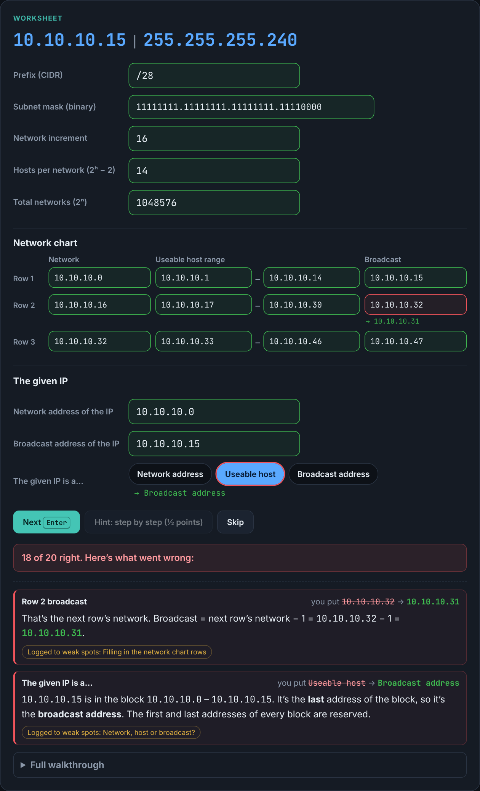

### Two difficulty levels
- **Last octet (/24–/30):** subnetting inside the 4th octet. Start here.
- **Stretch (/16–/30):** the subnet boundary can land in the 3rd octet.

### Learn from every answer
- Wrong answers get feedback aimed at the exact mistake, for only the boxes you missed. It catches things like rounding up instead of down, swapping the last usable and broadcast boxes, forgetting the − 2 in the host formula, using the wrong increment, reading binary backwards, or ORing instead of ANDing. If one wrong answer was caused by another (say, a broadcast that's right for the wrong network you entered), it tells you which one to fix.
- A **Full walkthrough** is one tap away: the IP and mask lined up in binary (network bits blue, host bits yellow), the increment, and a small subnet table with your network highlighted.
- **Hint** walks you through the question step by step (see below) for half points, and links to the matching section of the guide.

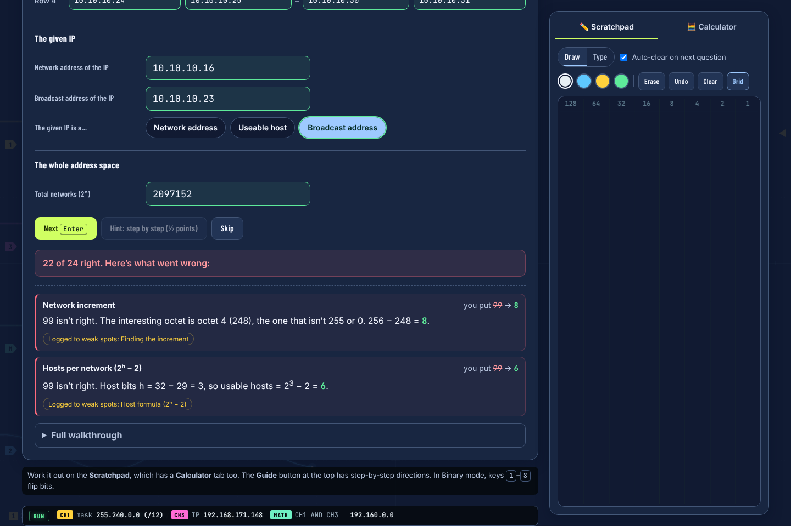

### Step-by-step hints
Every question has a **Hint** that swaps the answer boxes for a step-by-step walkthrough built around the questions themselves. A small copy of the worksheet or chart stays at the top with the current question highlighted, and below it are the steps for that one question. Its last step is the answer, which goes straight into that box before moving on to the next question. Each step also shows a ⚡ shortcut for that specific step (for example, a mask octet is always 1s followed by 0s), and a shortcut is never shown if it would contain that step's answer. Each step is checked before you move on. The steps never state the answer they're asking for: a wrong try gets a nudge toward the method, not the number. **Show me** reveals a step only if you ask, and **Fill in the answers** (or **Back to the answer boxes**) brings the answer boxes back. For example:

- **Decimal → binary:** for each place value from 128 down, does it fit in what's left? (1 or 0)
- **Binary → decimal:** count the 1 bits, then keep a running total of their place values.
- **Prefix → mask:** how many full octets of 255, how many bits are left over, what they add up to, then write the mask.
- **ANDing:** find the interesting octet, write the IP and mask octets in binary, AND them, convert back, write the network.
- **Subnet chart:** interesting octet, mask value, increment, round down, network, broadcast, usable hosts.
- **Formulas:** work out host bits, powers of 2 and prefixes one piece at a time.

Using a hint makes that question worth half points.

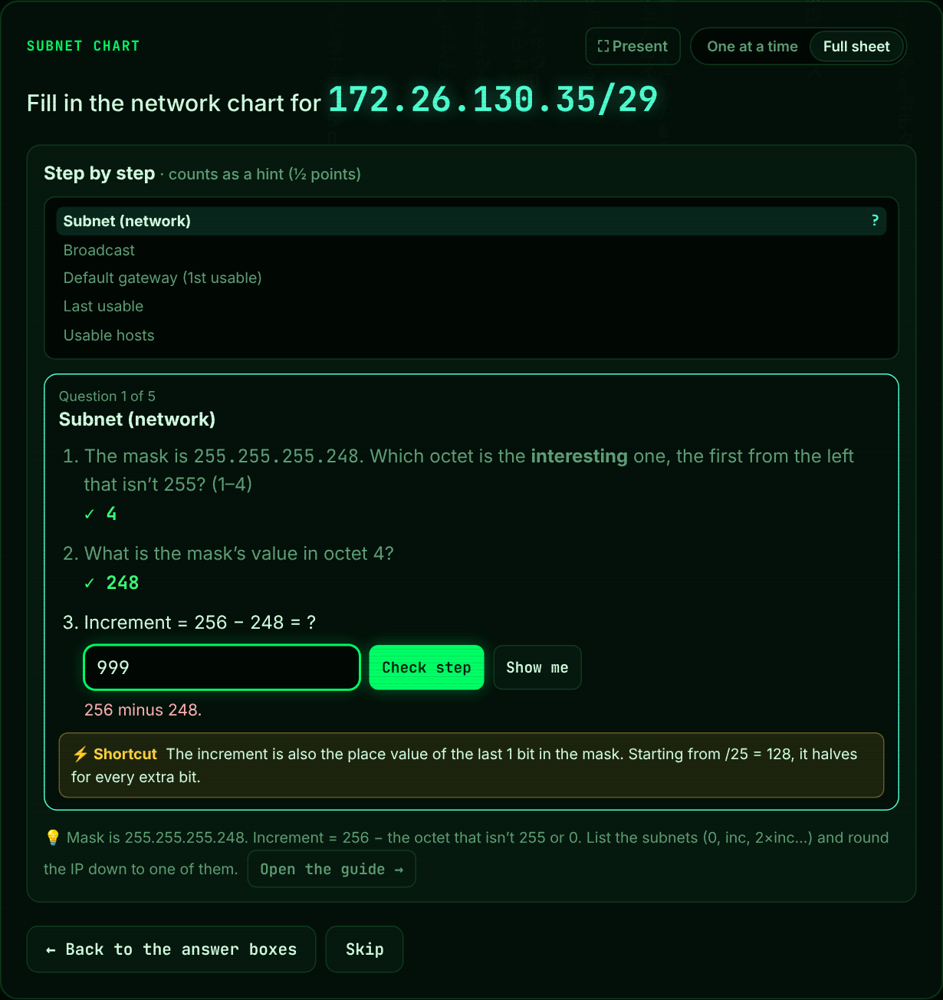

### Weak spots
Every mistake the feedback recognises is logged by type: rounding up, forgetting the − 2, swapping boxes, reading binary backwards and about 25 others. The **Weak spots** tab picks questions that target the mistakes you make most, labels what each one is drilling, and shrinks a weak spot as you get matching questions right. Your log is saved in your browser and can be reset at any time.

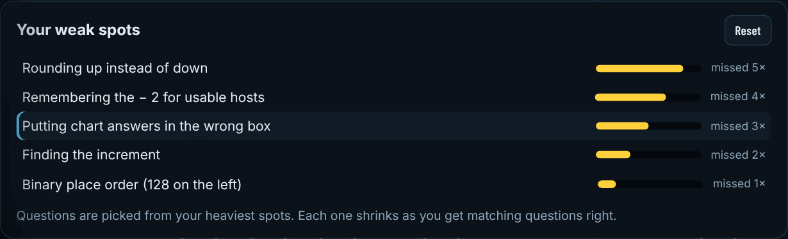

### Built-in tools
- **✏️ Scratchpad:** draw with a mouse, finger or stylus over an optional 128 → 1 bit grid (four pen colours, eraser, undo). Or switch to **Type** mode, which has one-tap bit-header and subnet-chart templates. It can clear itself on each new question.
- **🧮 Calculator:** + − × ÷, parentheses, **2ˣ**, **xʸ**, **Ans**, and a tappable history. It deliberately has no binary converter or subnet calculator, so it helps with the math without giving away answers.
- **📋 Guide:** step-by-step directions for subnet charts, ANDing, the "round down" rule, binary, prefix ↔ mask, formulas and stretch mode, each with a worked example, plus a /24–/30 reference table.

### Score & challenge
- Score, streak, best streak and accuracy, plus per-mode counts on each tab.
- **⏱ 2-minute challenge:** answer as many mixed questions as you can, then try to beat your personal best.

### Mobile-friendly
On phones, the tools open from a bottom bar as a half-height panel, so the question stays visible while you work. Tap **Bigger** for a near-full-screen scratchpad (the question stays pinned at the top). Answer boxes bring up the number keyboard, and **Go** jumps to the next box.

<p>
  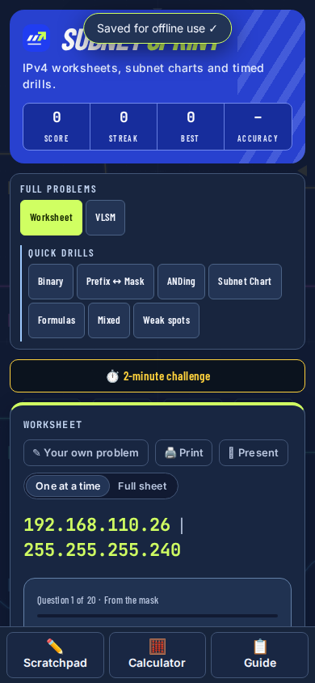
  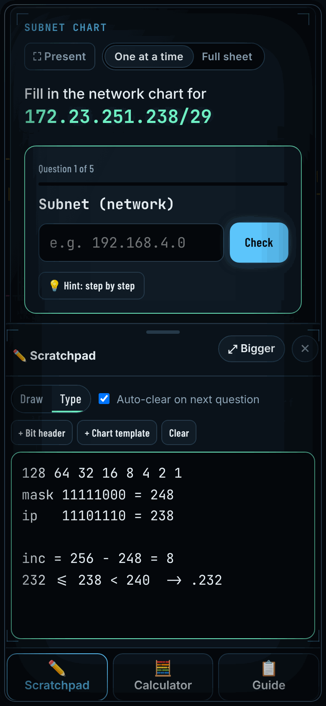
  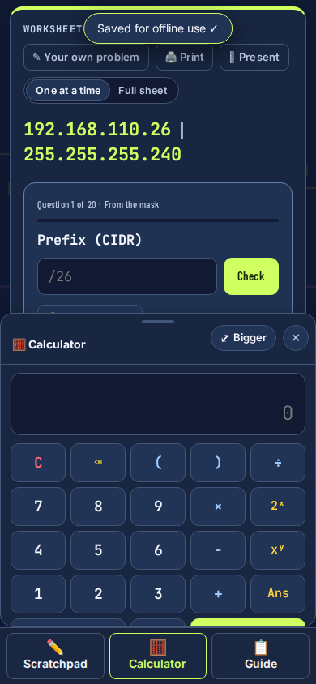
</p>

### Keyboard shortcuts (desktop)
| Key | Action |
|---|---|
| `Enter` | Check answer / next question |
| `1`–`8` | Flip bits left to right in Binary mode |
| `Enter` / `Esc` in the calculator | Evaluate / clear |

---

## Install it and use it offline
Subnet Sprint works as an app. Install it once and it opens full screen from its own icon, and keeps working with no internet connection.

- **iPhone / iPad:** open the site in Safari, tap **Share**, then **Add to Home Screen**. (The **Install app** button next to the title shows these steps.)
- **Android / Chrome / Edge:** tap **Install app** next to the title, or use the browser's install option.

A service worker saves a copy of the game on your device on your first visit. Online, you always get the newest version (and the saved copy is refreshed); offline, the saved copy loads instead. Your scores and weak spots are stored on the device either way.

## Security
The game is a static page with no server, accounts or data collection, so the main risks are someone injecting code into the page or disguising it inside another site. It's hardened against both:

- **Typed input is never run.** Anything you type (answers, walkthrough steps, calculator, notes) is escaped before it's shown, so HTML or script just appears as text.
- **Content Security Policy.** The page only runs its own script file (`app.js`): no inline scripts, no scripts from other sites, no plugins, forms or `<base>` tags. Even if something slipped past the escaping, the browser would refuse to run it.
- **No third-party requests.** Fonts are self-hosted (SIL Open Font License, see `fonts/`), and the page sends no referrer, so nothing about your visit goes to another site.
- **Saved data is validated.** Scores and weak spots read back from browser storage are checked and cleaned, so tampered or corrupted data can't inject anything or crash the game.
- **No framing.** If another site loads the game inside a frame, it shows a link to the real page instead.
- **No `eval`.** The calculator uses its own small parser.
- The service worker only handles and caches this site's own files.

`tests/test_security.py` attacks all of this: it types injection payloads into every input in every mode, tampers with saved data, injects a script tag directly, and frames the page from another origin.

## How subnetting works (quick version)

Using `172.16.62.68/26`:

1. **Prefix → mask:** /26 = 26 ones → `255.255.255.192`
2. **Interesting octet:** the one that isn't 255 or 0 → the 4th (`192`)
3. **Increment:** 256 − 192 = **64**
4. **List subnets:** 0, 64, 128, 192
5. **Round down:** 68 falls in the **.64** subnet
6. **Fill in:** network `.64` · gateway `.65` · last usable `.126` · broadcast `.127` (next subnet − 1) · hosts 2⁶ − 2 = **62**

The in-app Guide covers ANDing, binary, formulas and /16–/23 prefixes the same way.

---

## Running it locally

The app is a few static files ([`index.html`](index.html), `app.js`, fonts and icons) with no build step and no dependencies. Download the repo and open `index.html` in a browser.

To host it yourself, any static host works (GitHub Pages, Netlify, a USB stick…).

## Tests

The `tests/` folder has twelve [Playwright](https://playwright.dev/python/) scripts:

- **`test_answers.py`** generates hundreds of random questions in every mode and at both levels, computes the correct answers independently with Python's `ipaddress` module, types them in, and checks that the game marks them correct and that every explanation renders cleanly.
- **`test_ui.py`** runs 93 checks of every control: hints, scoring, streaks, timed challenge, scratchpad drawing/erasing/undo, typed notes, calculator, guide, keyboard shortcuts, the phone layout and bottom panel, and running with browser storage blocked.
- **`test_feedback.py`** feeds in 45 common mistakes and checks each gets the matching explanation, then answers 15,000 random questions with junk and near-miss input to make sure feedback appears for every wrong box and never for a right one.
- **`test_practice.py`** runs 80 full walkthroughs at both levels (with deliberate wrong steps), checks that mistakes are logged to the right weak spot, that the Weak spots tab drills them, that right answers shrink them, and that the walkthrough fits a phone screen.
- **`test_offline.py`** serves the site locally, loads it once, cuts the network, and plays a full question offline. It also checks that a new version is picked up when back online, and that the install button works on Chrome and gives iPhone directions.
- **`test_security.py`** tries to inject code through every input and through tampered saved data, checks the Content Security Policy blocks inline and outside scripts, confirms nothing loads from other sites, and checks the page refuses to run inside another site's frame.
- **`test_touch.py`** uses simulated finger swipes on a phone and tablet to check the Guide and Calculator panels scroll (with momentum) without moving the page behind them, and that tapping keys and drawing on the scratchpad still work.
- **`test_worksheet.py`** loads the five problems from the class solutions guide and checks every worksheet answer and chart row matches it, then checks 15 common mistakes get the right explanation.
- **`test_hints.py`** generates 15,000 questions across every question type and checks every hint's steps lead to the real answer and handle junk input, scans every step and nudge to make sure none states the answer it's asking for, then works through 40 hints on screen with deliberate wrong steps and answers each question for half points.
- **`test_flow.py`** checks the one-at-a-time layout: questions appear in working order, the chart builds as you go, wrong tries get a nudge without the answer and are logged, per-question hints, Show the answer, first-try scoring, and switching to Full sheet. It also checks the instructor tools: loading your own problem (and rejecting invalid or malicious input), share links, a printed PDF with two problems per page plus the answer key, and Present mode. Finally it confirms a whole worksheet fits a 360px phone.
- **`test_vlsm.py`** checks VLSM mode against the class handout's example (58, 29, 15 and 7 hosts), then checks 400 random problems (biggest first, smallest block that fits, aligned blocks with no gaps, all inside the /24). It also checks the feedback for 12 common VLSM mistakes, the hints, both layouts, your own problem and share links (including bad and malicious input), printing two problems per page with an answer key, and that a whole problem fits a 360px phone.
- **`test_lab.py`** checks Packet Tracer lab mode against the class's 11.7.5 lab answers, then 300 random networks (subnet count, bits borrowed, Addressing Table rules, no duplicate addresses). It also checks feedback for 13 addressing mistakes and 14 IOS command mistakes, a full run typed with command abbreviations, hints, the part picker, your own lab and share links (including bad and malicious input), the printed handout and key, and that the whole lab fits a 360px phone.

```bash
pip install playwright
playwright install chromium
python tests/test_answers.py      # N=200 python tests/test_answers.py for a longer run
python tests/test_ui.py
python tests/test_feedback.py
python tests/test_practice.py
python tests/test_offline.py
python tests/test_security.py
python tests/test_touch.py
python tests/test_hints.py
python tests/test_worksheet.py
python tests/test_flow.py
python tests/test_vlsm.py
python tests/test_lab.py
```

## Built with

Plain HTML, CSS and JavaScript (`index.html` and `app.js`) with no frameworks or build step, plus self-hosted [Inter](https://rsms.me/inter/) and [JetBrains Mono](https://www.jetbrains.com/lp/mono/) fonts. Scores and weak spots are saved only in your own browser.

## About

Made by **Christian Krantz** as a study aid for the network addressing unit of the AAS Networking & Cybersecurity program at State Technical College of Missouri.

## License

[MIT](LICENSE)
